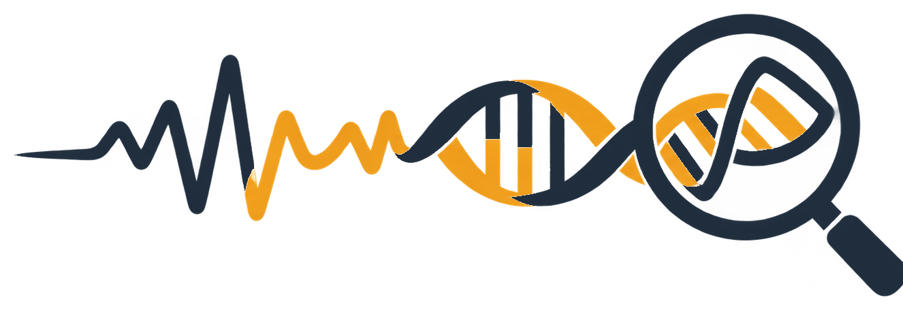

<p align="center">
  <picture>
    <source media="(prefers-color-scheme: dark)" srcset="assets/SignalScope_logo_dark.png">
    
  </picture>
</p>

<h1 align="center">SignalScope</h1>
<p align="center">Long-read gene panel analysis for Oxford Nanopore adaptive sampling</p>
<p align="center">
  
  
  
</p>

SignalScope is a Snakemake workflow for Oxford Nanopore (ONT) adaptive-sampling data from
disease gene panels. From aligned reads (or POD5/FASTQ) it calls single nucleotide variants
(SNVs) and small insertions/deletions with two callers (Clair3 and DeepVariant), structural
variants (SVs, 50 bp or more) with two callers (Sniffles2 and cuteSV), annotates them, applies a
decision tree based on a subset of the ACMG/AMP criteria, and writes a self-contained HTML report
with IGV screenshots for review.

## Intended use

SignalScope is a **research tool**. Its output is a prioritised list of candidates to support
review by qualified staff; it is not a diagnostic test and does not replace a laboratory's own
validated methods. Any finding must be confirmed by the laboratory's validated workflow before
clinical use. Running it on patient samples requires the approvals of your own institution
(ethics, data governance).

**Patient data stay on your server by default.** Two settings send information outside:
- `decision_tree.gnomad_remote: true` reads variant **positions** from the public gnomAD files on
  Google Cloud (default `false`; keep it `false` for patients);
- `avi.enabled: true` sends variants to the Google DeepMind AlphaGenome service (WGS mode only,
  default `false`; its terms exclude clinical use).

Links in the report (ClinVar, gnomAD, VarSome, OMIM) open those websites, and so share the variant
with them, only when the user clicks.

## Requirements

| | Tested with |
|---|---|
| Linux, 16+ cores, 64 GB+ RAM | Linux server, 20 cores, 128 GB |
| NVIDIA GPU (recommended; DeepVariant and Clair3 use it) | GeForce RTX 3090, driver 550 |
| Apptainer | 1.4.5 |
| Snakemake | 5.10.0 |
| Python 3 with pandas, numpy, matplotlib, pysam, pillow | |
| conda environment: minimap2, samtools, bcftools, Sniffles2, cuteSV, WhatsHap, mosdepth, NanoPlot | Sniffles2 2.7.5, cuteSV 2.1.3, WhatsHap 1.7, bcftools 1.24, samtools 1.23.1 |
| IGV desktop (headless, for screenshots) | 2.19.7 |

Without a GPU the pipeline still runs; DeepVariant then runs on the CPU and is much slower.

## Installation

```bash
git clone https://github.com/RafaellaSB/signalscope.git && cd signalscope
conda env create -f envs/signalscope.yml && conda activate signalscope
```

### Containers

Build the three Apptainer images once and give their paths in `config.yaml`:

```bash
apptainer pull deepvariant_1.10.0-gpu.sif   docker://google/deepvariant:1.10.0-gpu
apptainer pull clair3_v2.0.1_gpu.sif        docker://hkubal/clair3:v2.0.1_gpu
apptainer pull ensembl-vep_release_116.0.sif docker://ensemblorg/ensembl-vep:release_116.0
# check the versions
apptainer exec deepvariant_1.10.0-gpu.sif run_deepvariant --version     # DeepVariant version 1.10.0
apptainer exec clair3_v2.0.1_gpu.sif /opt/bin/run_clair3.sh --version  # Clair3 v2.0.1
```

### Clair3 models

Put the Clair3 models matching your basecaller in one folder (`clair3.model_dir`). With
`clair3.model: auto` the pipeline reads the basecaller model from the BAM header
(`@RG DS:basecall_model=...`) and selects the installed model with the same accuracy (fast, hac,
sup), version and chemistry; it stops, saying which model to install, when none matches. For a BAM
without that tag, set `clair3.basecall_model` in the sample config.

### Annotation resources

Download these once and give their paths under `resources:` in `config.yaml`. SignalScope does
not include or redistribute them; each has its own terms, which every user must check and accept.

| Setting | Resource | Terms (checked Nov 2026) |
|---|---|---|
| `clinvar_vcf` | ClinVar VCF, GRCh38 (NCBI) | NCBI; please check the ClinVar maintenance and use page |
| `clingen_genes`, `clingen_regions`, `clingen_validity` | ClinGen dosage sensitivity curation lists (gene, region) and gene-disease validity | CC0 1.0; ClinGen asks for attribution and date accessed, and states its content is not intended for direct diagnostic use without review by a genetics professional |
| `gnomad_sv`, `gene_constraint`, `gnomad_cache` | gnomAD v4.1 SV sites, constraint metrics; local frequency cache | gnomAD terms of use (gnomad.broadinstitute.org/terms) |
| `lr_sv` | CoLoRSdb v1.2.0 long-read SV frequencies, GRCh38 (`CoLoRSdb.GRCh38.v1.2.0.pbsv.jasmine.vcf.gz` and its index; Zenodo doi 10.5281/zenodo.14814308) | CC BY 4.0 (cite CoLoRSdb) |
| `mim2gene` | OMIM `mim2gene.txt` | OMIM terms (omim.org/downloads) |
| `vep_plugin_data/revel/` | REVEL v1.3 scores | free for non-commercial use; other uses: contact the REVEL authors |
| `vep_plugin_data/spliceai/` | SpliceAI precomputed scores (masked, SNV; indel optional) | free for academic and not-for-profit use; other use requires a commercial licence from Illumina |
| `gtf`, `region_index` | Ensembl GRCh38 release 116 GTF (the region index is built from it on the first run) | Ensembl terms (ensembl.org) |
| `sv_exon_bed` | protein-coding exons of all genes, +-20 bp, from the GTF | built locally (see below) |
| VEP cache | Ensembl VEP 116 offline cache, GRCh38 | Ensembl terms (ensembl.org) |

SpliceAI scores are used for SNVs; indel scores are used when the indel score file is present
(`spliceai_scores.masked.indel.hg38.vcf.gz` in `vep_plugin_data/spliceai/`).

## Running a sample

1. Fill in `config.yaml` once (tools, containers, reference, resources). The pipeline stops at the
   start and lists any setting still holding a `<placeholder>`.
2. Copy `config/sample.template.yaml` to `config/<sample>.yaml` and fill it in (BAM, panel BED,
   sex, panel name). Examples: `config/examples/`.
3. Dry run, then run:

```bash
snakemake -n --configfile config/<sample>.yaml --config sample=<sample> --cores 12
snakemake    --configfile config/<sample>.yaml --config sample=<sample> --cores 12
```

`--cores` caps the cores used by all jobs together; lower it on a shared server.

### Panel BED

Four columns: chromosome, start, end, gene name. `chr1` and `1` naming both work (the BED is
harmonised to the reference). For DeepVariant give the same intervals with the first three
columns only (`deepvariant_bed`).

### Gene table

The decision tree needs, per gene, the mode of inheritance (MOI). Two tables are included:
- `assets/gene_tables/hcp_gene_table_panelapp.tsv`: the ONT Hereditary Cancer Panel genes rated
  green in PanelApp Australia (snapshot of 16 Oct 2026 in `assets/panels/`), with the MOI from
  PanelApp and its source in the `moi_source` column. Panel genes outside this table are still
  sequenced and called, but their variants do not enter the gene-based tiers;
- `assets/gene_tables/kidgen_gene_table.tsv`: the KidGen CKD panel (33 genes).

For another panel:
- leave `decision_tree.gene_table` empty: the table is built from the gene names in the panel
  BED, with the MOI from the ClinGen gene-disease validity file (Definitive, Strong or Moderate
  curations; genes without a usable curation keep an empty MOI and are tested under both
  models). Every gene gets a provenance line;
- give a curated table, for example from PanelApp Australia or UK with `scripts/panelapp_fetch.py`
  (its output has the columns the decision tree reads):

```bash
python3 scripts/panelapp_fetch.py --search kidney
python3 scripts/panelapp_fetch.py --panel <id> --out assets/gene_tables/<panel>.tsv
```

## What the decision tree reports

- **Small variants (SNVs, indels):** tiers from the decision tree (ACMG/AMP subset), with the mode
  of inheritance from the gene table. The rules are listed in the report's Methods section and at
  the top of `scripts/classify_small_variants.py`.
- **Structural variants (50 bp or more):** tiered by the impact on the gene (coding exon of the
  MANE/canonical transcript, whole transcript, ClinGen dosage region), the evidence (found by both
  callers, at least 3 supporting reads; an SV found by one caller only is capped at Tier 3), the
  population frequency (gnomAD-SV and CoLoRSdb; common = AF above 1% in either, absent from both =
  "frequency unknown") and the mode of inheritance, including a heterozygous SV in a recessive
  gene paired with a small variant in the same gene.
- **Phase:** small variants and SVs carry a haplotype (phase set) when the reads allow it. A pair of
  variants in a recessive gene is reported as in trans, in cis (not counted as two hits) or phase
  unknown.

## Output

`<samples_root>/<sample>/report/html/<sample>.report.html`: the report (self-contained; open in
a browser). Variant calls, annotation and the decision-tree tables are in the sample folder
(`variants/`, `interpretation/`); tool versions in `report/data/<sample>.tool_versions.tsv`.

## Settings and benchmark

The defaults in `config.yaml` are the settings benchmarked against GIAB HG002 v5.0q at 10x-40x
(whole genome, Clair3 v2.0.1 and DeepVariant 1.10.0, PASS calls):

| Setting | Default | Why |
|---|---|---|
| DeepVariant small model | off (`deepvariant.small_model: false`) | no gain at 20x-40x; at 10x it lowered SNV recall to 0.49 |
| SV minimum size | 50 bp (Sniffles2 and cuteSV) | the SV benchmark threshold |
| cuteSV minimum support | 10 (cuteSV default) | as benchmarked; 5 raises recall at 20x-30x with slightly lower precision |
| Clair3 model | `auto` | matched to the basecaller model of the reads |

SVs found by only one caller are labelled "found by one caller only: confirm in IGV" in the report.

## Tests

```bash
for t in tests/test_*.py; do python3 "$t" | tail -n 1; done
```

## Citation

A manuscript describing SignalScope is in preparation. Until it is published, please cite this
repository (see `CITATION.cff`, or "Cite this repository" on GitHub).

## Licence

SignalScope is released under the MIT licence (`LICENSE`). The annotation resources and tools it
uses are not included and keep their own licences and terms (see Annotation resources).
